# Hospitality OS / QR Menu SaaS — System Architecture

> **Product:** Multi-tenant QR table-ordering, Kitchen Display System (KDS), Admin Command Center, GST thermal billing and direct-UPI payments for cafes and restaurants (India).
> **Stack:** Next.js 16.4 (App Router, Turbopack) · React 19 · TypeScript 5 · Tailwind CSS 4 · Zod 4 · Framer Motion · Supabase (PostgreSQL + RLS + Realtime) · Vercel
> **Document basis:** Derived from the source code as of November 2026. Every section separates **✅ Implemented (as-built)** from **🟡 Designed / Not yet wired (target)**.

---

## Table of Contents

1. [Executive Summary & Current Maturity](#1-executive-summary--current-maturity)
2. [System Context (C4 Level 1)](#2-system-context-c4-level-1)
3. [Container Architecture (C4 Level 2)](#3-container-architecture-c4-level-2)
4. [Repository & Module Map](#4-repository--module-map)
5. [Frontend Architecture](#5-frontend-architecture)
6. [Backend Architecture (API & Domain Services)](#6-backend-architecture-api--domain-services)
7. [Data Architecture](#7-data-architecture)
8. [Security Architecture](#8-security-architecture)
9. [Core Business Flows](#9-core-business-flows)
10. [Real-Time Architecture](#10-real-time-architecture)
11. [Payment Architecture](#11-payment-architecture)
12. [Printing & Receipt Architecture](#12-printing--receipt-architecture)
13. [Multi-Tenancy Model](#13-multi-tenancy-model)
14. [Infrastructure, Deployment & Environments](#14-infrastructure-deployment--environments)
15. [Observability & Operations](#15-observability--operations)
16. [Testing Strategy](#16-testing-strategy)
17. [Known Gaps & Risk Register](#17-known-gaps--risk-register)
18. [Target-State Migration Roadmap](#18-target-state-migration-roadmap)
19. [Cost & Capacity Model](#19-cost--capacity-model)
20. [Appendices](#20-appendices)

---

## 1. Executive Summary & Current Maturity

The system lets a guest scan a table QR, browse a menu in a mobile browser (no app install), customise drinks, place an order and pay by UPI. The order appears on a kitchen display, the admin dashboard updates, and a GST-compliant receipt can be printed on an 80 mm thermal printer. Payments go straight to the restaurant's UPI VPA, so there is no gateway commission.

The codebase has **two layers at different maturity levels**:

| Layer | State | Description |
| :--- | :--- | :--- |
| **Presentation + demo state engine** | ✅ Built | Full UI for Customer, KDS, Admin, Operator, Receipt. State lives in a React Context backed by `localStorage` and synced between *browser tabs* using `BroadcastChannel`. |
| **Server domain layer** | ✅ Built, tested | Zod-validated order creation, server-side pricing, idempotency, order state machine, payment ledger, RBAC, session tokens, receipt generators. Uses an **in-memory repository**. |
| **Database schema + RLS** | ✅ Authored, ⚠️ not connected | Two SQL migrations and a seed file are ready. No runtime code queries Supabase yet (`@supabase/supabase-js` is installed but unused). |
| **Client ↔ Server integration** | 🔴 Not wired | The UI never calls `/api/orders/*`. Only auth and operator screens call the API. |
| **Cross-device realtime** | 🔴 Not wired | `BroadcastChannel` only works across tabs of the same browser on one device. Supabase Realtime is designed but not implemented. |

> [!IMPORTANT]
> Today the product is a **high-fidelity, single-device demo with a production-grade backend domain core**. To serve real restaurants, the integration steps in [§18](#18-target-state-migration-roadmap) must be completed.

---

## 2. System Context (C4 Level 1)

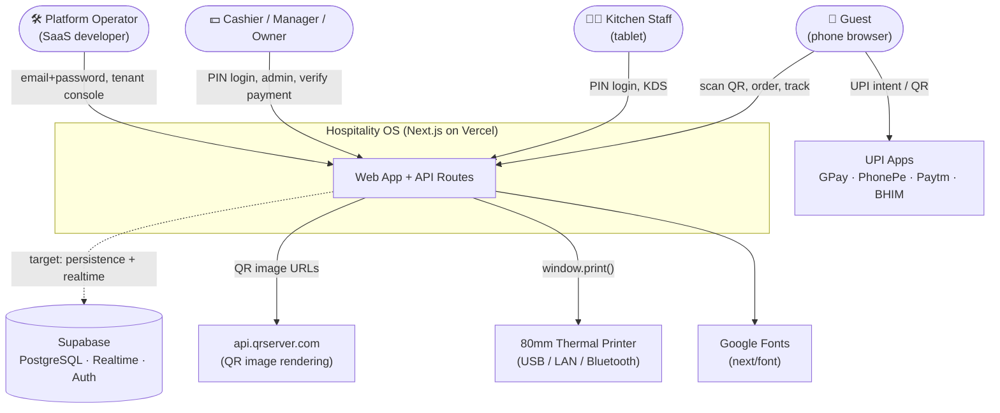

### Actors

| Actor | Entry point | Auth | Purpose |
| :--- | :--- | :--- | :--- |
| **Guest** | `/menu?table=…` | None (anonymous, profile in `localStorage`) | Browse, customise, order, pay, track |
| **Chef / Barista** | `/kds`, `/chef`, `/kitchen` | 4-digit PIN | Work the ticket board, toggle 86 |
| **Cashier** | `/admin` (target), receipt | PIN | Verify payments, print bills |
| **Manager / Owner** | `/admin` | PIN | Menu, QR studio, KPIs, staff |
| **Platform Operator** | `/operator` | Email + password (scrypt) or PIN | Onboard/suspend/renew tenants |

---

## 3. Container Architecture (C4 Level 2)

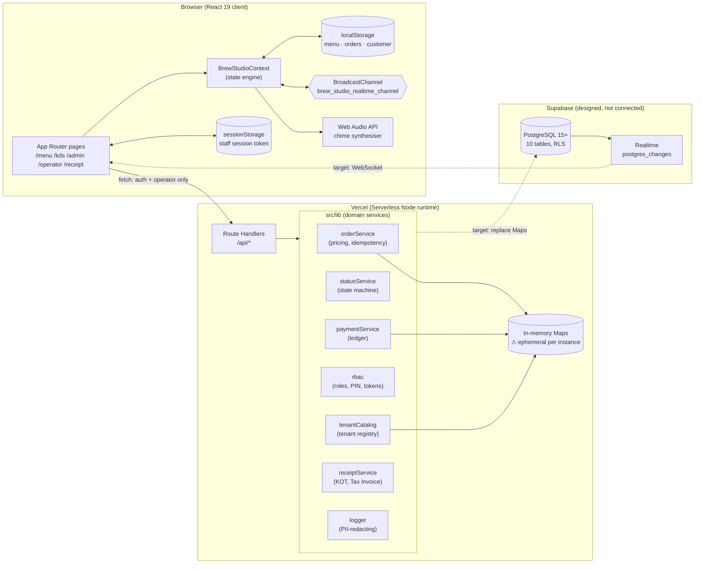

### Runtime responsibilities

| Container | Responsibility | Technology |
| :--- | :--- | :--- |
| Browser SPA | Rendering, cart, local demo state, audio alerts, print | React 19, Tailwind 4, Framer Motion, lucide-react, canvas-confetti |
| Next.js Route Handlers | HTTP API, authz enforcement, input validation | `next/server`, Zod |
| Domain services | Business rules independent of HTTP | Plain TypeScript modules in `src/lib` |
| Supabase | Durable multi-tenant storage, RLS, realtime (target) | PostgreSQL, `pgcrypto` |

---

## 4. Repository & Module Map

```
QR mentu SaaS/
├── src/
│   ├── app/                              # Next.js App Router
│   │   ├── layout.tsx                    # Fonts, <BrewStudioProvider>, <DemoSwitcherBar>
│   │   ├── page.tsx                      # Root redirect
│   │   ├── globals.css                   # Tailwind + @media print (80mm)
│   │   ├── menu/page.tsx                 # Guest ordering experience
│   │   ├── kds/page.tsx · chef/page.tsx  # Re-export of /kitchen
│   │   ├── kitchen/page.tsx              # KDS (StaffAuthGuard: chef|manager|owner)
│   │   ├── admin/page.tsx                # Command Center (StaffAuthGuard: owner|manager)
│   │   ├── operator/page.tsx             # SaaS operator console (dev login)
│   │   ├── receipt/page.tsx              # 80mm tax receipt + print/download
│   │   └── api/
│   │       ├── health/route.ts           # GET   liveness + memory
│   │       ├── auth/staff-pin/route.ts   # POST  PIN → signed token
│   │       ├── auth/developer-login/     # POST  email+password → token
│   │       ├── operator/tenants/route.ts # GET/POST/PATCH tenant management
│   │       └── orders/
│   │           ├── create/route.ts       # POST  validated order creation
│   │           ├── status/route.ts       # POST  state-machine transition
│   │           └── verify-payment/       # POST  cashier payment verification
│   ├── components/
│   │   ├── Customer/   MenuCard · BaristaCustomizer · CartDrawer · LiveOrderTracker
│   │   │               MoodCompass · BrandHero · CustomerOnboardingModal
│   │   ├── Kitchen/    KdsHeader · KdsKanbanBoard · KitchenTicketCard
│   │   ├── Admin/      AdminKpiCards · OrdersFeedTable · MenuManager · QrStudio
│   │   ├── Auth/       StaffAuthGuard (PIN pad + developer login)
│   │   └── Navigation/ DemoSwitcherBar
│   ├── context/BrewStudioContext.tsx     # Client state engine (~840 LOC)
│   ├── lib/
│   │   ├── orders/     orderService · statusService · paymentService
│   │   ├── catalog/    tenantCatalog
│   │   ├── security/   rbac
│   │   ├── printing/   receiptService
│   │   └── logger.ts
│   ├── data/initialMenu.ts               # 23-item seed menu + sample orders
│   ├── types/index.ts                    # Shared client types
│   └── utils/sound.ts                    # Web Audio chimes
├── supabase/
│   ├── migrations/20261027000001_initial_schema.sql
│   ├── migrations/20261027000002_rls_policies.sql
│   └── seed.sql                          # Brew Studio + Blue Tokai
├── tests/                                # node:test suites (3 files, ~16 tests)
├── public/images/                        # Menu photography
├── *.md                                  # Audit, deployment, DR, cost, RLS docs
└── build_*.js · capture_*.js · generate_pdf.js   # Sales-deck / screenshot tooling (not runtime)
```

---

## 5. Frontend Architecture

### 5.1 Rendering model

* **App Router** with client components (`'use client'`) for all interactive screens.
* `layout.tsx` wraps everything in `BrewStudioProvider` and a top `DemoSwitcherBar` (a demo navigation aid; should be removed or hidden in production).
* Fonts via `next/font/google`: Playfair Display (editorial), Plus Jakarta Sans (UI), JetBrains Mono (tickets and numerics).
* Images from `/public/images` plus `images.unsplash.com` and `api.qrserver.com`, allowed by `next.config.ts` `remotePatterns`.

### 5.2 Route map

| Route | Audience | Guard | Main components |
| :--- | :--- | :--- | :--- |
| `/` | All | — | Redirect |
| `/menu` | Guest | none | `BrandHero`, `MoodCompass`, `MenuCard`, `BaristaCustomizer`, `CartDrawer`, `LiveOrderTracker`, `CustomerOnboardingModal` |
| `/kitchen` (+ `/kds`, `/chef`) | Kitchen | `StaffAuthGuard(chef, manager, owner)` | `KdsHeader`, `KdsKanbanBoard`, `KitchenTicketCard` |
| `/admin` | Owner / Manager | `StaffAuthGuard(owner, manager)` | `AdminKpiCards`, `OrdersFeedTable`, `MenuManager`, `QrStudio` |
| `/operator` | Platform operator | In-page developer login | Tenant table, onboarding form |
| `/receipt` | Guest / Cashier | none | Thermal receipt, print/download |

> [!NOTE]
> The guard is **client-side only** (see [§8.4](#84-authorization-model-and-enforcement-points)). Server routes do enforce permissions, but pages and the context mutate local state without calling them.

### 5.3 State engine — `BrewStudioContext`

The single source of truth in the browser.

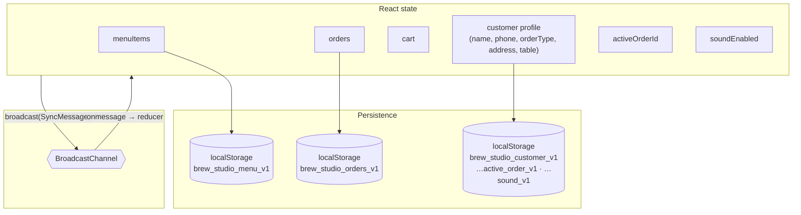

**Exposed actions**

| Group | Actions |
| :--- | :--- |
| Cart | `addToCart`, `updateCartQuantity`, `removeFromCart`, `clearCart` |
| Orders | `placeOrder`, `updateOrderStatus`, `toggleOrderItemCheck`, `cancelOrder`, `setActiveOrderById` |
| Menu (admin) | `toggleItemAvailability` (86), `toggleItemFeatured`, `updateItemPrice`, `addMenuItem` |
| Profile | `completeOnboarding`, `updateCustomerProfile`, `resetOnboarding` |
| Utility | `toggleSound`, `setCurrentTable`, `resetToDemoDefaults`, `seedRandomOrder` |

**`SyncMessage` protocol** (`BroadcastChannel`): `ORDER_CREATED`, `ORDER_STATUS_CHANGED`, `ITEM_CHECK_TOGGLED`, `MENU_ITEM_AVAILABILITY_TOGGLED`, `MENU_ITEM_UPDATED`, `MENU_ITEM_ADDED`, `RESET_DEMO_DATA`.

**Client-side pricing (UX only):** `unitPrice = menuItem.price + Σ(bean, milk, sweetness, boosters)`. The authoritative price is recomputed server-side in `orderService`.

### 5.4 Customer experience (`/menu`)

1. **Onboarding modal** captures name, phone and order type (`DINE_IN` / `TAKEAWAY` / `DELIVERY`) and stores them in `localStorage`.
2. **Table resolution** reads `?table=` from the URL (via `useSearchParams`). Takeaway uses `Takeaway Counter`. Delivery uses `Delivery · <address>`.
3. **Mood Compass** filters by `MoodKey`: `all | high-caffeine | cold | sweet | manual | food`.
4. **Barista Customizer** modal covers temperature, bean, milk, sweetness, boosters and a special note.
5. **Cart Drawer** offers a payment mode choice (`instant_upi` / `upi_counter`) and places the order.
6. **Live Order Tracker** shows `new → brewing → ready → completed`, with confetti on ready and a ready chime.

### 5.5 Kitchen Display System

* **Kanban board** with columns by status. Tickets are colour-coded by wait time (green under 5 min, amber 5–12, red over 12).
* **Station split:** `barista` vs `kitchen` per line item, each with a per-item completion checkbox (`completedInKitchen`).
* **Actions:** start (brewing), ready, complete, cancel.
* **Audio:** `playCafeOrderChime` and `playOrderReadyChime` are synthesised with the Web Audio API, so there is no audio asset latency.
* **86 control:** chefs hold the `menu:toggle_86` permission.

### 5.6 Admin Command Center

* **KPI cards:** revenue, order count, AOV, active tickets, best seller (computed client-side from `orders`).
* **Orders feed:** live audit table with print KOT / invoice actions (`window.print()`).
* **Menu manager:** 86 toggle, price edit, featured flag, add item.
* **QR Studio:** builds `…/menu?table=NN` URLs, renders QR images via `api.qrserver.com`, and prints a standee layout.

### 5.7 Operator console (`/operator`)

Developer-only SaaS control plane. It logs in via `/api/auth/developer-login`, then lists, onboards, suspends, activates and renews tenants via `/api/operator/tenants`.

---

## 6. Backend Architecture (API & Domain Services)

### 6.1 Layering

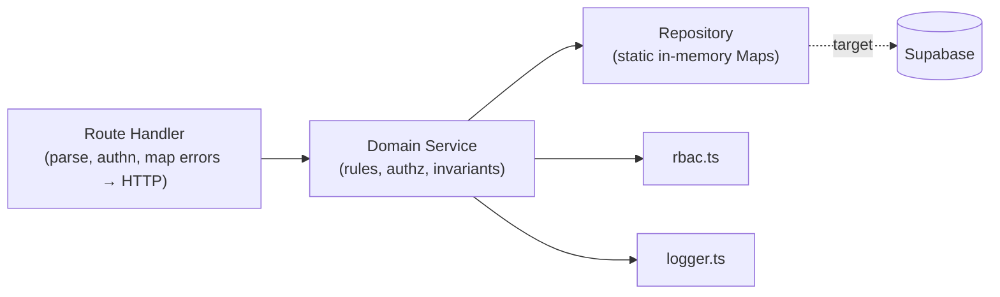

Route handlers stay thin. All business invariants live in `src/lib/**`, so the domain code can be unit-tested without HTTP (see `tests/`).

### 6.2 API surface

| Method & Path | Auth | Request (key fields) | Behaviour | Status codes |
| :--- | :--- | :--- | :--- | :--- |
| `GET /api/health` | none | — | Status, ISO time, version `1.0.0-PROD`, uptime, heap MB | 200 |
| `POST /api/auth/staff-pin` | none (rate-limited) | `pin`, `restaurantId?`, `role?` | Verifies PIN against staff list, returns a 12 h signed token | 200, 400, 401, 429, 500 |
| `POST /api/auth/developer-login` | none (rate-limited) | `email`, `password` | scrypt + `timingSafeEqual` verification, returns a `platform_operator` token | 200, 400, 401, 429, 500 |
| `GET /api/operator/tenants` | ⚠ none | — | Lists tenants | 200 |
| `POST /api/operator/tenants` | ⚠ none | `name, slug, upiVpa, phone, address?, gstin?, fssai?, taxRate?` | Creates a tenant and registers it in the catalog | 201, 400, 409, 500 |
| `PATCH /api/operator/tenants` | ⚠ none | `tenantId`, `action: suspend\|activate\|renew` | Updates subscription state | 200, 404, 500 |
| `POST /api/orders/create` | none (guest) | `restaurantId, tableNumber, customerName, customerPhone, orderType, paymentMode, items[], idempotencyKey?` | Server-priced, validated, idempotent order creation | 200 (retry), 201, 400, 404 |
| `POST /api/orders/status` | Bearer token | `orderId`, `status` | Applies a legal state transition | 200, 400, 401, 403 |
| `POST /api/orders/verify-payment` | Bearer token | `orderId, amount, paymentMode, transactionReference?, notes?` | Records a ledger entry and marks the order paid | 200, 400, 401, 403 |

> [!WARNING]
> `/api/operator/tenants` currently has **no authentication check**. The page performs a login, but the API itself does not verify the token. See the [Risk Register](#17-known-gaps--risk-register).

### 6.3 Order service (`orderService.ts`)

**Input schema (Zod)**

| Field | Rule |
| :--- | :--- |
| `restaurantId` | non-empty string |
| `tableNumber` | non-empty string |
| `customerName` | 1–100 chars |
| `customerPhone` | `^\+?[0-9\s-]{10,15}$` |
| `orderType` | `DINE_IN \| TAKEAWAY \| DELIVERY` (default `DINE_IN`) |
| `paymentMode` | `instant_upi \| upi_counter \| cash \| card` |
| `items[]` | at least 1; each has `menuItemId`, `quantity` 1–50, optional `customization`, optional `clientPrice` (audit only) |
| `customization.specialNote` | max 200 chars |
| `idempotencyKey` | 8–128 chars, optional |

**Pipeline in `createValidatedOrder`**

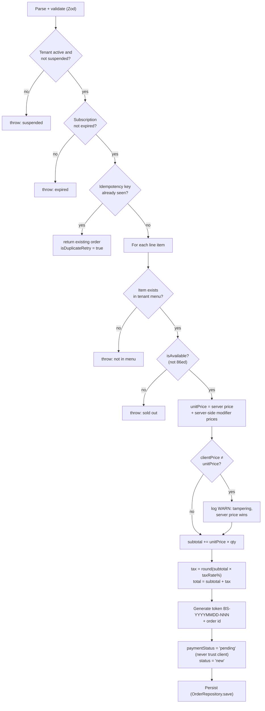

Key invariants:

* **Server is price authority.** The client price is only compared and logged.
* **Modifier pricing** is looked up by key `${type}:${name.toLowerCase()}` in the tenant modifier catalog. Unknown or unavailable modifiers add ₹0.
* **GST** defaults to 5%. It is split 2.5% CGST + 2.5% SGST at print time.
* **Idempotency** is scoped as `restaurantId:key`.
* **`paymentStatus` is always `pending`** on creation.

### 6.4 Order lifecycle (`statusService.ts`)

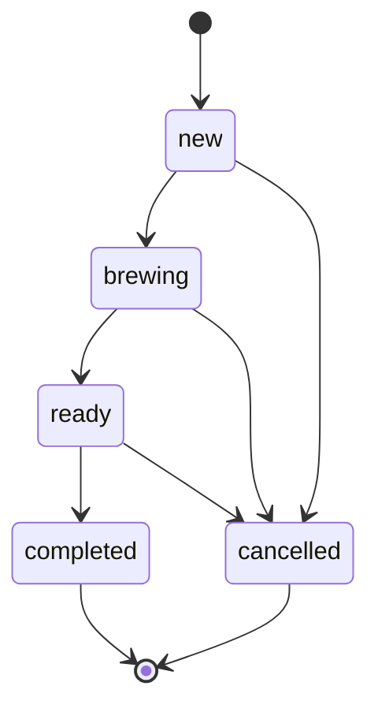

Checks, in order:

1. The caller needs `orders:update_kitchen_status` or `orders:update_status`.
2. The order must exist.
3. `order.restaurantId === session.restaurantId`, unless the caller is `platform_operator`.
4. The target status must be in `LEGAL_TRANSITIONS[current]`.

Illegal jumps such as `new → completed` are rejected.

### 6.5 Payment ledger (`paymentService.ts`)

Checks, in order:

1. The caller needs `payments:verify`.
2. The order must exist.
3. The tenant boundary must hold.
4. The order must not already be `paid`.
5. `amount >= order.total`. Underpayment is rejected.
6. A `PaymentRecord` is written with `verifiedByStaffId`, `verifiedByStaffName`, `transactionReference` (UTR), `status: 'verified'` and a timestamp.
7. `order.paymentStatus = 'paid'`.

### 6.6 Tenant catalog (`tenantCatalog.ts`)

* In-memory `Map` keyed by both `id` and `slug`.
* Seeded with **Brew Studio** (`a0000000-…-0001`, slug `brew-studio`), built from `INITIAL_MENU_ITEMS` plus 10 modifiers (beans, milks, sweetness, boosters).
* `registerTenant()` is called by the operator `POST`. A new tenant starts with an **empty** menu and modifier list.
* `/api/orders/create` falls back to the Brew Studio id when `restaurantId` is omitted.

### 6.7 Logger (`logger.ts`)

Structured JSON logger (`debug | info | warn | error`) with **sensitive-key redaction** (for example `authorization`). Used for tamper warnings, duplicate retries and order and payment audit events.

---

## 7. Data Architecture

### 7.1 Entity-relationship model (PostgreSQL / Supabase)

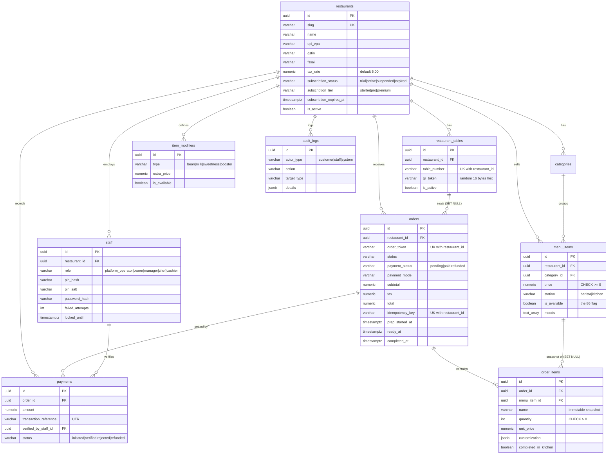

### 7.2 Integrity features

| Concern | Mechanism |
| :--- | :--- |
| Tenant isolation | `restaurant_id` FK on every operational table, plus RLS |
| Duplicate orders | `UNIQUE (restaurant_id, idempotency_key)` |
| Token collisions | `UNIQUE (restaurant_id, order_token)` |
| Bad money values | `CHECK` constraints on price, subtotal, tax, total, amount |
| Historical accuracy | `order_items` stores name, unit price and customisation as a snapshot. `menu_item_id` is `ON DELETE SET NULL`. |
| Enumerations | `CHECK … IN (…)` on status, role, station, order type, payment mode |
| Query performance | Indexes on `(restaurant_id, status)`, `(restaurant_id, created_at DESC)`, `(restaurant_id, is_available)`, `order_items(order_id)`, `payments(order_id)` and others |
| Table QR validation (target) | `restaurant_tables.qr_token` random 128-bit hex |

> [!NOTE]
> **Schema drift to resolve:** the migration defines `order_daily_sequence` (a *global* sequence) but the app's token format is per-restaurant per-day (`BS-YYYYMMDD-NNN`). The in-memory counter satisfies this today. The DB version needs a per-tenant, per-day counter, for example a `order_counters(restaurant_id, day, last_value)` table with `INSERT … ON CONFLICT DO UPDATE … RETURNING`.

### 7.3 Row-Level Security (summary)

RLS is enabled on all 10 tables. Context comes from Postgres session settings (`app.current_tenant_id`, `app.staff_role`) read by helper functions `current_app_tenant()`, `current_staff_role()` and `is_platform_operator()`.

| Table | Public / anonymous | Staff | Operator |
| :--- | :--- | :--- | :--- |
| `restaurants` | `SELECT` where active and not suspended | owner, manager `UPDATE` own row | `ALL` |
| `staff` | ✗ | owner, manager `ALL` in tenant | `ALL` |
| `restaurant_tables` | `SELECT` active | owner, manager `ALL` | — |
| `categories` | `SELECT` all | owner, manager `ALL` | — |
| `menu_items` | `SELECT` all | owner, manager, chef `ALL` (enables 86) | — |
| `item_modifiers` | `SELECT` available | owner, manager, chef `ALL` | — |
| `orders` | ✗ | owner, manager, chef, cashier `SELECT` and `UPDATE` | `SELECT` |
| `order_items` | ✗ | via parent order tenant | via parent |
| `payments` | ✗ | owner, manager, cashier `ALL` | `ALL` |
| `audit_logs` | ✗ (insert only) | owner, manager `SELECT` | `SELECT` |

See also [RLS_POLICY_INVENTORY.md](./RLS_POLICY_INVENTORY.md).

> [!WARNING]
> **RLS review notes**
> * There is **no `INSERT` policy on `orders` / `order_items`** for guests. Guest order creation must go through a server route using the service-role key, which bypasses RLS. It must not use the anon key.
> * `categories` and `menu_items` public read is **not tenant-scoped**. The app must always filter by `restaurant_id`, otherwise one tenant's menu is visible to every guest.
> * `orders_staff_update` allows `chef` and `cashier` to update any column, including `payment_status`. A column-level restriction or a trigger would enforce the state machine in the database.
> * `audit_logs_insert WITH CHECK (TRUE)` lets any role forge audit rows. Restrict it to the service role.
> * `tables_public_read` exposes `qr_token` to everyone, which defeats signed-QR validation. Expose tokens through a server route only.

### 7.4 Seed data

`supabase/seed.sql` provisions **Brew Studio** and **Blue Tokai** test tenants. `src/data/initialMenu.ts` holds 23 menu items (₹119–₹299) across categories `hot-coffee`, `iced-coffee`, `manual`, `non-coffee`, `signatures`, `espresso`, `bakehouse`, plus sample orders.

---

## 8. Security Architecture

### 8.1 Identity & authentication

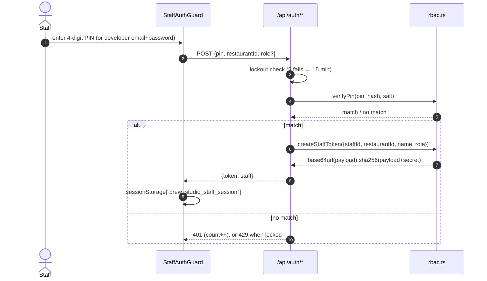

| Mechanism | Implementation | Notes |
| :--- | :--- | :--- |
| Password hashing | `scrypt` (64-byte key, 16-byte random salt), compared with `timingSafeEqual` | Strong |
| PIN hashing | `SHA-256(pin + salt)`, `timingSafeEqual` | A 4-digit PIN has only 10⁴ values. Offline brute-force is trivial if the hashes leak. Rate limiting is the main defence. |
| Session token | `base64url(JSON) + "." + hex(SHA-256(payload + secret))`, 12 h expiry | **Not an HMAC/JWT.** Prefer `createHmac('sha256', secret)` or `jose` (see [§17](#17-known-gaps--risk-register)). |
| Token transport | `Authorization: Bearer <token>` | Stored in `sessionStorage` (readable by XSS) |
| Lockout | In-memory `Map` keyed by `restaurantId:pin` (PIN route) and `dev:<email>` (developer route) | Resets on cold start and is not shared across instances |

### 8.2 Role-based access control

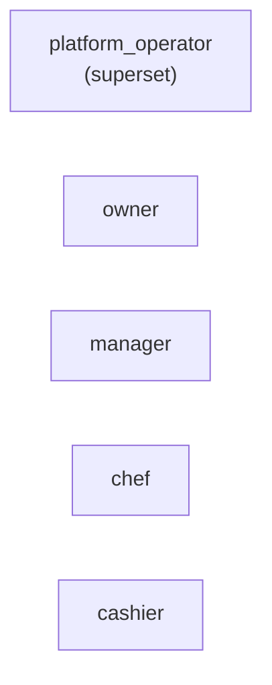

| Permission | operator | owner | manager | chef | cashier |
| :--- | :-: | :-: | :-: | :-: | :-: |
| `tenants:manage`, `subscriptions:manage`, `audit:read_all` | ✅ | | | | |
| `restaurant:update`, `staff:manage` | ✅ | ✅ | | | |
| `menu:manage`, `tables:manage` | ✅ | ✅ | ✅ | | |
| `orders:read`, `orders:update_status` | ✅ | ✅ | ✅ | | `read` only |
| `orders:read_kds`, `orders:update_kitchen_status` | ✅ | | | ✅ | |
| `menu:toggle_86` | ✅ | | | ✅ | |
| `payments:verify` | ✅ | ✅ | ✅ | | ✅ |
| `reports:view` | ✅ | ✅ | ✅ | | |
| `receipt:print` | ✅ | ✅ | ✅ | | ✅ |

### 8.3 Tenant isolation layers

| Layer | Control | Status |
| :--- | :--- | :--- |
| Application | `order.restaurantId === session.restaurantId` check in status and payment services (operator exempt) | ✅ Tested |
| Catalog | Orders validate only against the target tenant's own catalog | ✅ |
| Database | `restaurant_id` FK plus RLS | 🟡 Authored, not connected |
| Subscription gate | Suspended, inactive or expired tenants cannot receive orders | ✅ Tested |

### 8.4 Authorization model and enforcement points

| Surface | Enforcement | Verdict |
| :--- | :--- | :--- |
| `/api/orders/status`, `/api/orders/verify-payment` | Server: bearer token + permission + tenant check | ✅ Strong |
| `/api/orders/create` | Server: validation only (anonymous by design) | ✅ Appropriate. Needs abuse protection. |
| `/api/operator/tenants` | **None** | 🔴 Open |
| `/admin`, `/kitchen` pages | Client-side `StaffAuthGuard` | 🟡 UX gate only |
| Context mutations (`updateOrderStatus`, `toggleItemAvailability`, …) | None (local state) | 🔴 Bypassable until wired to the API |

### 8.5 Input & output safety

* Zod validation on order input. Manual validation on the other routes.
* Customer note capped at 200 characters. Phone number regex-validated.
* React escapes output by default. There is no `dangerouslySetInnerHTML` in the audited paths.
* Logger redacts sensitive keys.

### 8.6 Secrets & configuration

| Variable | Scope | Purpose |
| :--- | :--- | :--- |
| `NEXT_PUBLIC_APP_URL` | public | Base URL (QR links) |
| `NEXT_PUBLIC_SUPABASE_URL`, `NEXT_PUBLIC_SUPABASE_ANON_KEY` | public | Supabase client (RLS-bound) |
| `SUPABASE_SERVICE_ROLE_KEY` | **server only** | Privileged DB access. Never prefix with `NEXT_PUBLIC_`. |
| `STAFF_SESSION_SECRET` | server | Signs staff tokens |
| `PLATFORM_OPERATOR_SECRET` | server | Reserved (not referenced in code) |

> [!CAUTION]
> `rbac.ts` falls back to a **hard-coded default secret** when `STAFF_SESSION_SECRET` is unset. In production this must fail closed, so the app should refuse to start without the variable.

---

## 9. Core Business Flows

### 9.1 Guest order — target flow (server-authoritative)

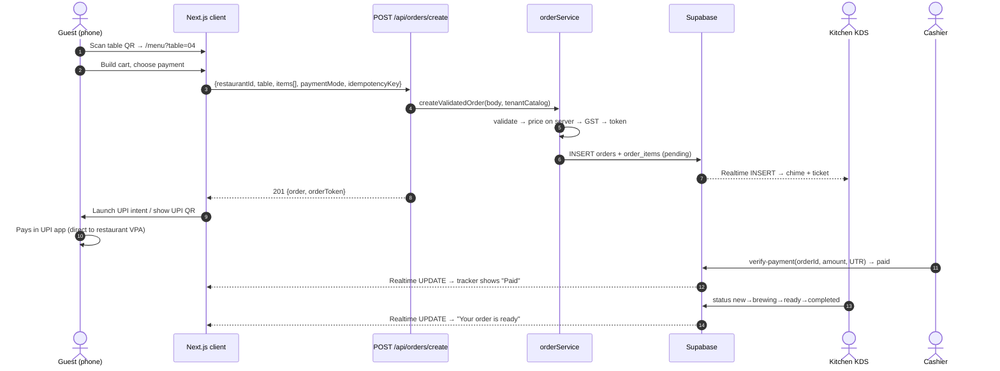

### 9.2 Guest order — as-built flow (demo)

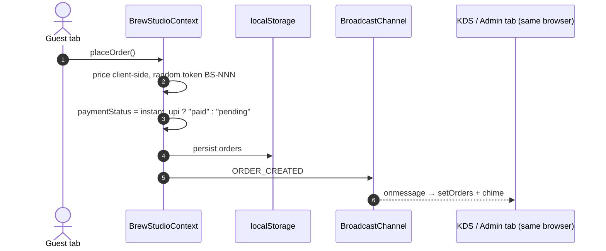

> [!WARNING]
> In the as-built flow, a client-asserted `paid` status and client-computed totals are trusted. The server routes are the secure path and must replace this logic before launch.

### 9.3 Tenant onboarding

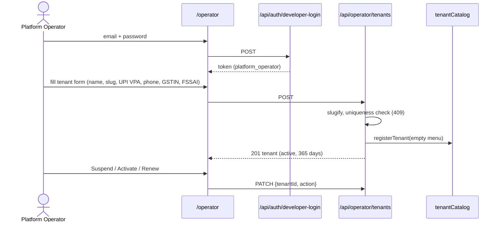

### 9.4 86 (out-of-stock) flow

* **As-built:** `toggleItemAvailability` updates local state and broadcasts `MENU_ITEM_AVAILABILITY_TOGGLED`.
* **Enforcement:** `orderService` rejects any unavailable item (`is currently sold out (86ed)`). Once the catalog is DB-backed, a toggle propagates to all guests' next order validation, and Realtime on `menu_items` updates their screens.

---

## 10. Real-Time Architecture

### 10.1 As-built

| Aspect | Detail |
| :--- | :--- |
| Transport | `BroadcastChannel('brew_studio_realtime_channel')` |
| Scope | Tabs/windows of the **same browser profile on one device** |
| Persistence | `localStorage` per device |
| Limitation | A guest's phone and the kitchen tablet cannot see each other's data |

### 10.2 Target (Supabase Realtime)

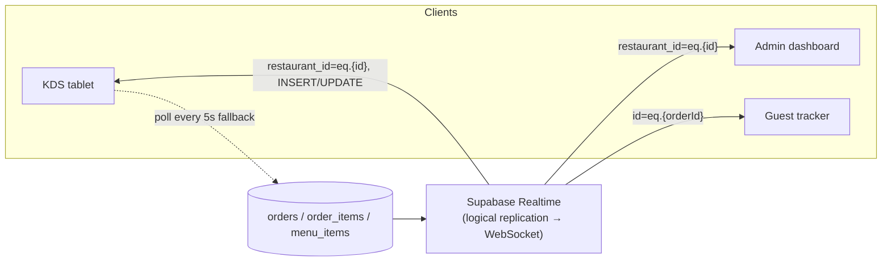

* **Channels:** one per restaurant for staff (`kitchen:{restaurantId}`). One per order for the guest tracker, filtered by order id.
* **Events:** `postgres_changes` `INSERT` and `UPDATE` on `orders`. `UPDATE` on `menu_items` for 86.
* **Resilience:** a 5-second polling fallback for flaky café Wi-Fi, and a reconnect-then-refetch on `SUBSCRIBED`.
* **Authorisation for guests:** Realtime respects RLS. Because guests have no `SELECT` policy on `orders`, the tracker needs either a server-issued read-only order token or a Broadcast channel keyed by an unguessable order id. Design this explicitly.
* **Prerequisite:** enable replication on `orders`, `order_items`, `menu_items` ([DEPLOYMENT_GUIDE.md](./DEPLOYMENT_GUIDE.md) §2.2).

---

## 11. Payment Architecture

### 11.1 Model: direct UPI, 0% commission

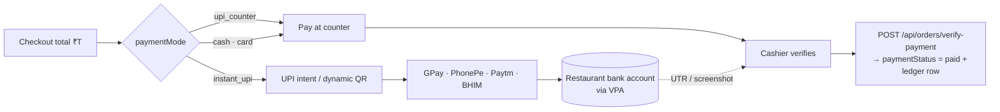

**Intent URL format (NPCI spec)**

```
upi://pay?pa=<vpa>&pn=<encoded name>&am=<total.00>&cu=INR&tr=<orderToken>&tn=<encoded note>
```

### 11.2 Trust model

* Direct UPI has **no machine-verifiable callback** to the app, so payment confirmation is **manual** (cashier enters the UTR) or via a future gateway webhook.
* The server enforces `amount >= total`, blocks double-payment, and records who verified the payment.
* **Invariant:** `paymentStatus` must never be set to `paid` from a client assertion. The server order service already guarantees this. The demo context violates it ([§17](#17-known-gaps--risk-register)).
* **Future options:** Razorpay or Cashfree UPI collect with webhooks (this adds MDR fees), or bank-statement or UTR auto-reconciliation.

### 11.3 Supported modes

| Mode | Meaning | Initial `paymentStatus` |
| :--- | :--- | :--- |
| `instant_upi` | Guest pays via UPI app/QR | `pending` until verified |
| `upi_counter` | Guest pays by UPI at counter | `pending` |
| `cash` | Cash at counter | `pending` |
| `card` | Card at counter | `pending` |

---

## 12. Printing & Receipt Architecture

| Artifact | Generator | Audience | Content |
| :--- | :--- | :--- | :--- |
| **KOT** (Kitchen Order Ticket) | `generateKot(order, station)` | Kitchen | Token, table, type, time, items with milk, roast, sweetness and chef note. **No prices.** Station filter (`barista \| kitchen \| all`). |
| **Tax Invoice** (Rule 46) | `generateTaxInvoice(order, restaurant)` | Guest | Restaurant name, address, phone, GSTIN, FSSAI, `INV-<token>`, items, subtotal, **CGST 2.5% + SGST 2.5%**, grand total, payment mode and status, SAC 996331 |
| **Receipt page** | `/receipt` (React + `@media print`) | Guest | Branded 80 mm layout, print and download slip |

**Delivery paths**

1. **Universal (built):** `window.print()` with 80 mm print CSS. It works on any OS-installed printer but shows the print dialog.
2. **Silent printing (target):** RawBT on Android POS tablets, or WebUSB / WebSerial / Web Bluetooth ESC/POS raw bytes.
3. **Server-side print queue (future):** an agent on a store PC polling a `print_jobs` table.

Supported hardware is any 58 mm or 80 mm ESC/POS printer (Epson, TVS, Xprinter, Everycom).

---

## 13. Multi-Tenancy Model

| Dimension | Design |
| :--- | :--- |
| **Model** | Shared application, shared database, `restaurant_id` discriminator (pooled multi-tenancy) |
| **Tenant identity** | `restaurants.id` (UUID) and `slug` (unique, `[a-z0-9-]`) |
| **Tenant config** | Name, tagline, UPI VPA, GSTIN, FSSAI, phone, address, tax rate, subscription status, tier and expiry |
| **Subscription tiers** | `starter`, `pro`, `premium`. Status: `trial`, `active`, `suspended`, `expired`. |
| **Lifecycle** | Operator onboards (default 365 days), suspends, activates, renews |
| **Commercial model** | About ₹9,000 per restaurant per year (see [PRODUCTION_READINESS_AUDIT.md](./PRODUCTION_READINESS_AUDIT.md)) |

**Tenant resolution (target)**

```
https://<host>/m/<slug>?table=04          ← recommended (path-based)
https://<slug>.<domain>/menu?table=04     ← optional (subdomain via middleware)
```

* **As-built:** `/menu` and the default API path use the hardcoded Brew Studio tenant. Scanning a second tenant's QR would show the wrong menu and UPI VPA. Dynamic slug routing (`/m/[slug]`) is the key missing piece.
* **Signed table QR (target):** `?table=04&token=<qr_token>` is validated against `restaurant_tables.qr_token`. The owner can rotate tokens to stop prank orders.

---

## 14. Infrastructure, Deployment & Environments

### 14.1 Deployment topology

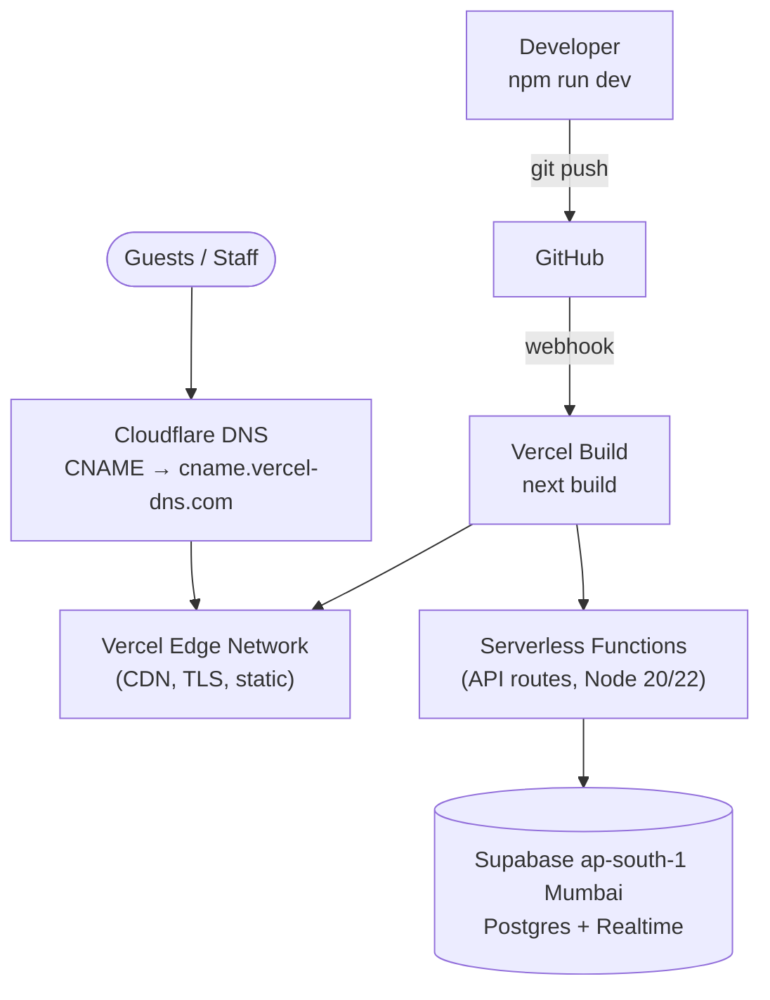

| Item | Value |
| :--- | :--- |
| Hosting | Vercel (Hobby for pilots, Pro for commercial SLA) |
| Runtime | Node.js 20.x / 22.x serverless |
| Build | `next build` (Turbopack), output `.next` |
| Database region | Supabase `ap-south-1` (Mumbai) for low latency in India |
| TLS | Automatic (Let's Encrypt via Vercel). Cloudflare mode: Full (Strict). |
| Migrations | Run in order in the Supabase SQL editor or Supabase CLI: `…000001_initial_schema.sql` → `…000002_rls_policies.sql` → optional `seed.sql` |

Step-by-step instructions: [DEPLOYMENT_GUIDE.md](./DEPLOYMENT_GUIDE.md).

### 14.2 Environments

| Env | Data | Notes |
| :--- | :--- | :--- |
| Local | In-memory + `localStorage` | `npm run dev`, `.env.local` from `.env.example` |
| Preview | Staging Supabase | Per-PR Vercel previews |
| Production | Production Supabase | Service-role key set for **Production only** |

### 14.3 Serverless implications

* Function instances are **ephemeral and isolated.** Static `Map`s (orders, payments, tenants, rate-limit counters) are **not shared** across instances and vanish on cold start. This is acceptable for tests and demos only. Every one of these must move to the database or a shared store (Supabase table, or Redis/Upstash for rate limits).
* Because the database enforces the real invariants (uniqueness, checks, RLS), routes should be stateless and safely retryable.

---

## 15. Observability & Operations

| Concern | Current | Recommended |
| :--- | :--- | :--- |
| Liveness | `GET /api/health` (uptime, heap, version) | Add a DB ping for readiness. Wire it to an uptime monitor. |
| Logging | Structured JSON with redaction (`logger.ts`) | Ship to Vercel Log Drains, Axiom or Datadog |
| Error tracking | None | Sentry (client and server) |
| Audit trail | `audit_logs` table (designed) | Write on order create, status change, payment verify, 86, price edit, staff login |
| Metrics | None | Order latency, failed validations, tamper warnings, login lockouts |
| Backups / DR | See [DISASTER_RECOVERY.md](./DISASTER_RECOVERY.md) | Supabase PITR (Pro tier) and a restore drill |

---

## 16. Testing Strategy

Runner: `node --experimental-strip-types --test tests/*.test.mjs` (`npm test`).

| Suite | Covers |
| :--- | :--- |
| `01_multi_tenant_and_security` | RBAC least-privilege matrix, salted PIN hash and verify, token signing, tamper detection and expiry, cross-tenant payment and status denial, developer password scrypt with no plaintext |
| `02_order_integrity_and_pricing` | Client price tampering overridden, server-side modifier pricing, 86ed item blocked, idempotent retries, cashier reconciliation and double-payment prevention |
| `03_lifecycle_and_printing` | Legal status progression, expired subscription blocks orders, KOT omits prices and shows chef notes, Rule 46 invoice content, collision-safe tokens under load |

**Gaps:** no API route tests (HTTP level), no UI or E2E tests (Playwright suggested), no database or RLS tests (`pgTAP` or Supabase test harness), no load tests.

Auxiliary scripts (`capture_*.js`, `test_onboarding_journey.js`, `generate_pdf.js`, `build_*deck*.js`) drive Puppeteer for screenshots and the sales PDF. They are **not** part of the runtime.

---

## 17. Known Gaps & Risk Register

| # | Severity | Area | Finding | Recommended fix |
| :-: | :-: | :--- | :--- | :--- |
| 1 | 🔴 P0 | Integration | `placeOrder`, `updateOrderStatus`, 86 toggles and the rest only touch `localStorage` and `BroadcastChannel`. Server APIs are never called. Orders never leave the guest's device. | Make the context call `/api/orders/*`. Hydrate from the DB. |
| 2 | 🔴 P0 | Persistence | Orders, payments, tenants and rate limits live in static in-memory `Map`s, which are lost on serverless cold starts. | Implement Supabase-backed repositories. Use the service-role key in server routes only. |
| 3 | 🔴 P0 | Payments | The client marks `instant_upi` orders as `paid` immediately. | Always create orders as `pending`. Confirm via cashier UTR or webhook. |
| 4 | 🔴 P0 | AuthZ | `/api/operator/tenants` (GET, POST, PATCH) has no authentication. | Require a bearer token with `tenants:manage`. |
| 5 | 🔴 P0 | Secrets | Developer identity, password and PIN hashes are **hard-coded in source**, including a test PIN `1234`, and a **default signing secret** fallback. | Move operator and staff credentials to the DB or environment. Rotate the secrets. Fail closed when `STAFF_SESSION_SECRET` is missing. |
| 6 | 🟠 P1 | Real-time | `BroadcastChannel` does not work across devices. | Supabase Realtime plus a polling fallback. |
| 7 | 🟠 P1 | Multi-tenancy | `/menu` and the API default to the hardcoded Brew Studio tenant. | Add `/m/[slug]` routing and require `restaurantId` in the API. |
| 8 | 🟠 P1 | Session crypto | Tokens use `SHA-256(payload+secret)` rather than HMAC. Staff tokens live in `sessionStorage`. The PIN keyspace is 10⁴. | Use HMAC-SHA256 or JWT (`jose`) in an `HttpOnly; Secure; SameSite=Strict` cookie. Add per-staff PIN identifiers (staff picker + PIN). |
| 9 | 🟠 P1 | Rate limiting | Lockout keyed by `restaurantId:pin` (attackers can rotate PINs) and held per instance. | Key by IP and tenant, and store in a shared store (Redis/Supabase). |
| 10 | 🟠 P1 | Abuse | The public order endpoint has no rate limit and no captcha. Table is a free-text string. | Add IP throttling, signed table QR tokens, and a per-table cooldown. |
| 11 | 🟠 P1 | RLS | No guest insert path. Missing tenant scoping on public reads. `orders_staff_update` can alter payment fields. `audit_logs_insert` is open. `qr_token` is publicly readable. | See [§7.3](#73-row-level-security-summary). |
| 12 | 🟡 P2 | Data model | The global `order_daily_sequence` doesn't match the per-tenant per-day token format. Client `Order.id` (`BS-NNN`) vs server UUID plus `order_token`. | Per-tenant counter table. Unify identifiers. |
| 13 | 🟡 P2 | Types | Client `types/index.ts` and server `ValidatedOrder` diverge (payment modes `cash`/`card`, `refunded`, ids). | Share a single schema package (Zod) between client and server. |
| 14 | 🟡 P2 | Printing | Relies on the browser print dialog. | Add RawBT / WebUSB silent printing. |
| 15 | 🟡 P2 | Dependency | QR images via a third-party API (`api.qrserver.com`). It is a privacy and availability dependency. | Generate QR codes locally (`qrcode` library, SVG). |
| 16 | 🟡 P2 | Ops | `DemoSwitcherBar`, `resetToDemoDefaults` and `seedRandomOrder` ship in production builds. | Gate behind a demo flag. |
| 17 | 🟡 P2 | Compliance | The invoice hard-codes the 5% CGST/SGST split. There is no sequential invoice numbering per GST rules. No DPDP consent for guest phone numbers. | Make the tax split configurable. Add a gapless invoice sequence. Add a consent notice and retention policy. |

---

## 18. Target-State Migration Roadmap

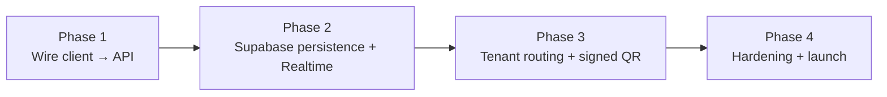

| Phase | Work items | Exit criteria |
| :--- | :--- | :--- |
| **1. Wire client to API** | `placeOrder` → `POST /api/orders/create` (send `idempotencyKey`). `updateOrderStatus` → `/api/orders/status` with the staff bearer token. Add a verify-payment UI for cashiers. Stop client-side `paid`. | The server's total and token are what the guest sees. Illegal transitions fail in the UI. |
| **2. Persistence + realtime** | Add `src/lib/supabase/server.ts` (service role) and `client.ts` (anon). Replace `OrderRepository`, `PaymentRepository` and `tenantCatalog` with DB queries. Add the per-tenant order-counter. Subscribe KDS, Admin and Tracker to Realtime. Add a 5 s polling fallback. | Order from phone A shows on tablet B in under 2 s. Restart-safe. |
| **3. Multi-tenant routing** | `/m/[slug]` page loading menu, branding and VPA by slug. Signed `?token=` table QRs. DB-backed operator console with auth. | Two tenants can run concurrently with no data crossover. |
| **4. Hardening & launch** | Fix all 🔴 and 🟠 items in [§17](#17-known-gaps--risk-register). HttpOnly cookies. Shared rate limiting. Sentry. RLS tests. E2E tests. Remove demo tooling. Production env vars. | `npm test` and `npm run build` pass. Security review passed. |

---

## 19. Cost & Capacity Model

**Assumed load (pilot):** about 10,000 guests per year, roughly 30 per day, roughly 1,000 sessions per month, roughly 10–15 GB bandwidth per month.

| Component | Provider | Tier | Monthly | Annual |
| :--- | :--- | :--- | :--- | :--- |
| Web hosting + serverless | Vercel | Hobby → Pro | \$0 – \$20 | \$0 – \$240 |
| Database + Realtime | Supabase | Free → Pro (PITR, no pausing) | \$0 – \$25 | \$0 – \$300 |
| Domain | Cloudflare / Namecheap | `.in` / `.com` | ~\$1 | ~\$12 |
| TLS + CDN | Included | — | \$0 | \$0 |
| **Total** | | | **~\$1 – \$46** | **~\$12 – \$552** |

> [!TIP]
> For commercial use, Vercel Hobby prohibits commercial usage and the Supabase free tier pauses inactive projects. Budget for **Pro tiers** once paying tenants are onboarded. Details: [HOSTING_COST_AND_SCALING.md](./HOSTING_COST_AND_SCALING.md).

**Scaling levers:** pooled DB (add read replicas and indexes already defined), stateless functions (horizontal by default once state is externalised), Realtime channel per tenant, image CDN for menu photography (compress the large JPEGs in `public/images`, which are about 0.7–0.9 MB each).

---

## 20. Appendices

### A. Order token & identifier formats

| Context | Format | Example |
| :--- | :--- | :--- |
| Server order token | `BS-YYYYMMDD-NNN` (per tenant, per day) | `BS-20261105-007` |
| Server order id (in-memory) | `order_<epoch>_<rand6>` | `order_1793…_k3j9ab` |
| DB order id | UUID v4 | `…` |
| Client demo order id | `BS-<3 digits>` | `BS-104` |
| Invoice number | `INV-<orderToken>` | `INV-BS-20261105-007` |
| Payment id | `pay_<epoch>_<rand6>` | — |

### B. Tax computation

```
subtotal = Σ (unitPrice × quantity)
tax      = round(subtotal × taxRate / 100)        # taxRate default 5.0
total    = subtotal + tax
CGST = SGST = round(tax / 2)                      # displayed on invoice
```

### C. Related documents

| File | Purpose |
| :--- | :--- |
| [PRODUCTION_READINESS_AUDIT.md](./PRODUCTION_READINESS_AUDIT.md) | Forensic audit and launch blueprint |
| [AUDIT_REPORT.md](./AUDIT_REPORT.md), [ACCEPTANCE_REPORT.md](./ACCEPTANCE_REPORT.md) | Earlier audit and acceptance results |
| [RLS_POLICY_INVENTORY.md](./RLS_POLICY_INVENTORY.md) | RLS policy listing |
| [DEPLOYMENT_GUIDE.md](./DEPLOYMENT_GUIDE.md) | Vercel + Supabase deployment steps |
| [DISASTER_RECOVERY.md](./DISASTER_RECOVERY.md) | Backup and recovery plan |
| [HOSTING_COST_AND_SCALING.md](./HOSTING_COST_AND_SCALING.md) | Cost and scaling analysis |

### D. Technology inventory

| Category | Package / Service | Version |
| :--- | :--- | :--- |
| Framework | `next` | 16.4.3 |
| UI | `react`, `react-dom` | 19.3.0 |
| Styling | `tailwindcss`, `@tailwindcss/turbopack` | ^4 |
| Animation / icons | `framer-motion` ^14, `lucide-react` ^1, `canvas-confetti` ^1.9 | — |
| Validation | `zod` | ^4.6 |
| Backend SDK | `@supabase/supabase-js` | ^2.118 (installed, **unused**) |
| Tooling | `typescript` ^5, `eslint` ^9, `puppeteer-core` ^25 (screenshots/PDF) | — |
| Node built-ins | `crypto` (scrypt, SHA-256, `timingSafeEqual`), `node:test` | — |
